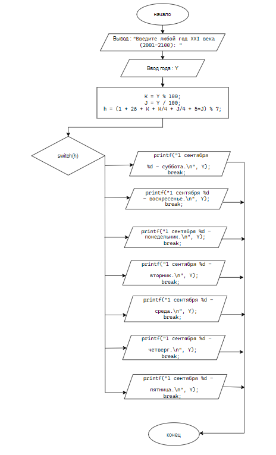

# Домашнее задание к lab7
### вариант 8
### Задача
Определить на какой день недели приходится 1 сентября произвольно заданного года XXI века.

### Решение

```
#define _CRT_SECURE_NO_DEPRECATE
#include <locale.h>
#include <stdio.h>
#include <math.h>
int main()
{
    setlocale(LC_ALL, "ru_RU.UTF-8");
    int Y;
    printf("Введите любой год XXI века (2001-2100): ");
    scanf("%d", &Y);
    int K = Y % 100;
    int J = Y / 100;
    //формула Целлера
    int h = (1 + 26 + K + K/4 + J/4 + 5*J) % 7;
    switch (h)
    {
    case 0:
        printf("1 сентября %d - суббота.\n", Y);
        break;
    case 1:
        printf("1 сентября %d - воскресенье.\n", Y);
        break;
    case 2:
        printf("1 сентября %d - понедельник.\n", Y);
        break;
    case 3:
        printf("1 сентября %d - вторник.\n", Y);
        break;
    case 4:
        printf("1 сентября %d - среда.\n", Y);
        break;
    case 5:
        printf("1 сентября %d - четверг.\n", Y);
        break;
    case 6:
        printf("1 сентября %d - пятница.\n", Y);
        break;  
    }
}
```

### Блок схема 


### Вывод
 Реализован алгоритм календарного расчёта дня недели для заданной даты.
